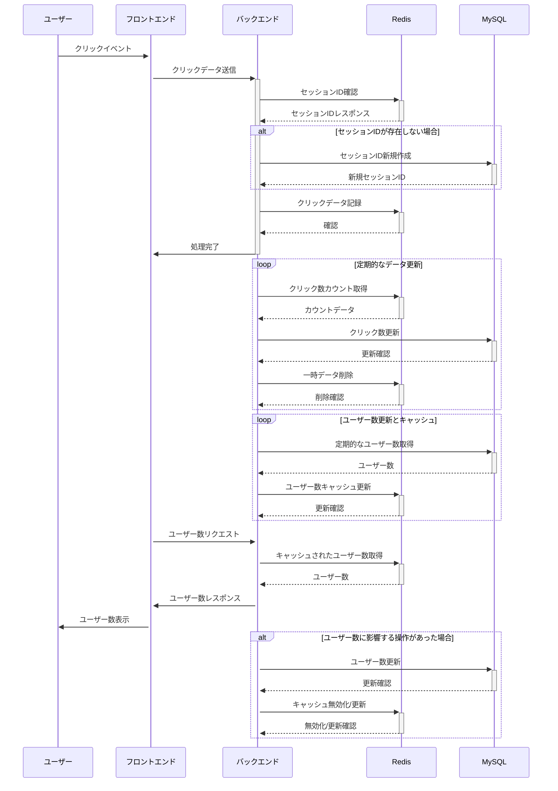

# 起動方法

## コンテナ起動

ターミナルで下記コマンド実行

```
docker compose up -d
```

## ブラウザアクセス

下記URLをブラウザのアドレスバーに入力

```
localhost:3000
```

# コンテナの各サービス概要

- back
  - バックエンド
  - APIs
    1. GET /count
       - timestampsテーブルにタイムスタンプを登録し、過去1秒間のアクセス数をDBから取得
    2. POST /cleanup
       - timestampsテーブルのタイムスタンプが過去2秒よりも以前のレコードを削除
- front
  - フロンエンド
  - 1秒おきに(i)のAPIをコールして表示
- redis
  - timestampsテーブルを配置
- cron
  - 1分おきに(ii)のAPIをコール

## シーケンス図


