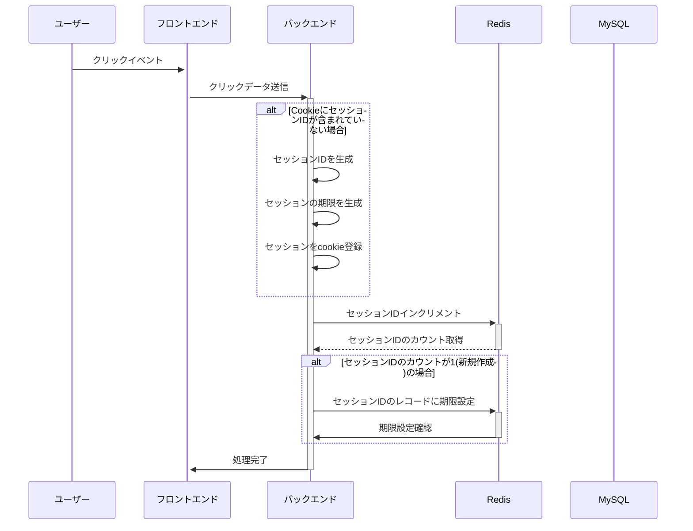
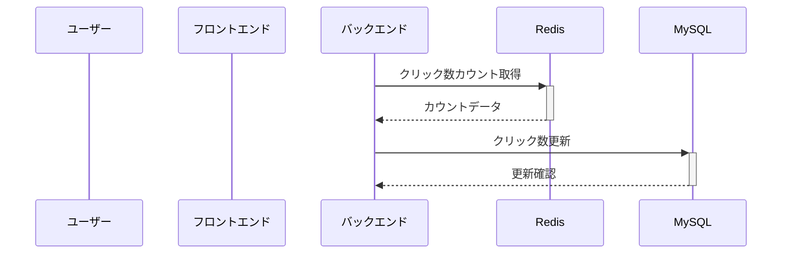
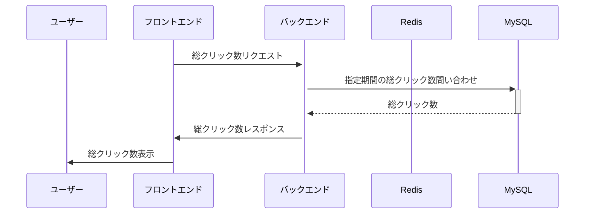
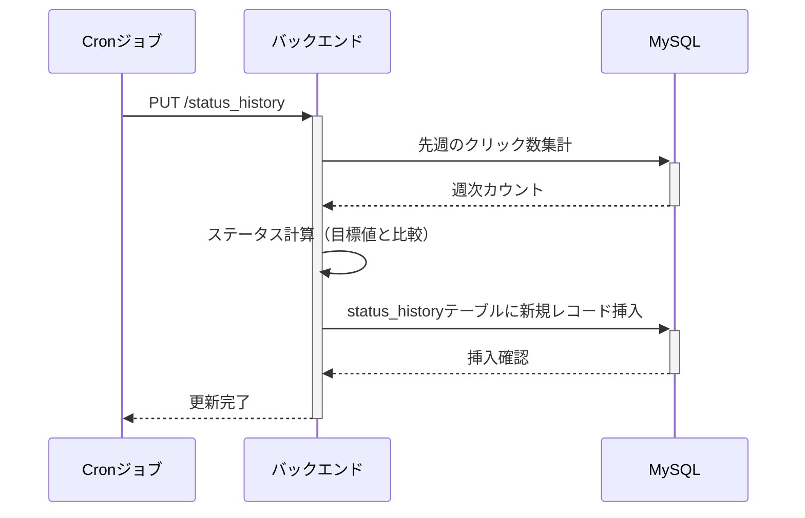

# 起動方法

## コンテナ起動

ターミナルで下記コマンド実行

```
docker compose up -d
```

## ブラウザアクセス

下記URLをブラウザのアドレスバーに入力

```
localhost:3001
```

# コンテナの各サービス概要

- back
  - バックエンド (ポート: 8881)
  - APIs
    
    ### セッション関連
    1. `POST /session`
       - クリックイベント処理
       - Cookieでセッション管理
       - RedisのセッションIDに対応するカウンタをインクリメント
       - 新規セッションの場合はCookieを設定し、value=1として作成
    
    2. `PUT /session`
       - Redis→MySQL同期（cronから定期実行）
       - RedisのセッションデータをMySQLのsession_counterテーブルにupsert
       - 既存レコードは累積カウントを更新、新規は作成
    
    3. `GET /session_counter?start_date=yyyy-mm-dd&end_date=yyyy-mm-dd`
       - セッションカウンタのサマリを取得
       - 指定期間のカウント合計を返す
       - パラメータ省略時はデフォルト期間を使用
    
    4. `GET /count_summary?start_date=yyyy-mm-dd&end_date=yyyy-mm-dd`
       - 後方互換性のためのエンドポイント
       - `/session_counter`と同じ機能
    
    ### ステータス履歴関連
    5. `PUT /status_history`
       - ステータス履歴の更新（週次ステータス計算）
       - 先週のクリック数を集計し、目標値と比較してステータスを決定
       - status_historyテーブルに新規レコードを追加
    
    6. `GET /status_history?limit=<n>&offset=<n>&start_date=yyyy-mm-dd&end_date=yyyy-mm-dd`
       - ステータス履歴の取得（ページネーション対応）
       - 現在のステータスと履歴を返す
       - limit: 取得件数上限（デフォルト: 100）
       - offset: 取得開始位置（デフォルト: 0）
       - 日付範囲指定可能
    
    ### ヘルスチェック
    7. `GET /health`
       - システム全体のヘルスチェック
       - MySQL、Redisの接続状態とレイテンシを返す
    
    8. `GET /health/liveness`
       - Kubernetesライブネスプローブ用
       - アプリケーションの生存確認
    
    9. `GET /health/readiness`
       - Kubernetes準備状態プローブ用
       - サービス提供可能状態の確認
- front
  - フロンエンド (ポート: 3001)
  - Rust/YewフレームワークによるWebAssemblyアプリケーション
  - 初回読み込み: `GET /count_summary`を呼び出して総クリック数を表示
  - クリック時: `POST /session`を呼び出してカウントを更新
- redis (ポート: 6380)
  - セッションベースのクリックカウンタキャッシュ
  - (key, value): (session_id, count) の期限付きKey-Valueストア
  - TTLはセッションCookieの有効期限と同期
- mysql (ポート: 7776)
  - 永続的なデータストレージ
  - テーブル:
    - `session_counter`: セッションごとのクリック数
    - `status_history`: 週次ステータス履歴（期間、カウント、ステータス）
  - [Database Definition](./doc/KazoeruKun/README.md)
- cron
  - 定期タスク実行コンテナ
  - 1分ごと: `PUT /session`を呼び出してRedis→MySQLへデータ同期
  - 週次: `PUT /status_history`を呼び出して週次ステータスを更新

## シーケンス図

### クリックイベント



### クリック数更新 Redis -> MySQL（定期実行）



### 画面表示



### 週次ステータス更新（定期実行）


