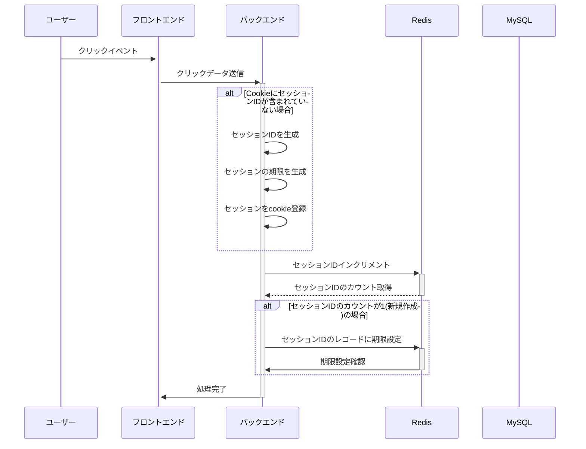
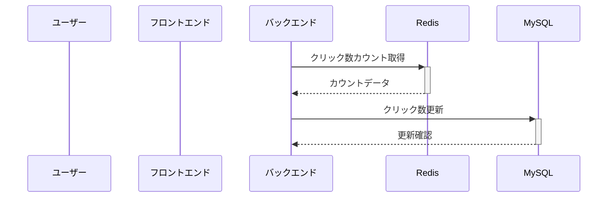
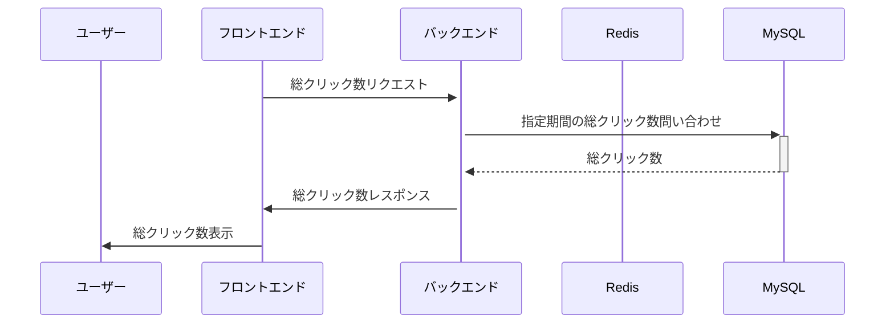

# 起動方法

## コンテナ起動

ターミナルで下記コマンド実行

```
docker compose up -d
```

## ブラウザアクセス

下記URLをブラウザのアドレスバーに入力

```
localhost:3000
```

# コンテナの各サービス概要

- back
  - バックエンド
  - APIs
    1. `POST /session -b 'session=<SESSION_ID>'`
       - クリックイベント
       - redisのkey:<SESSION_ID>に対応するvalueをカウントアップ。keyが存在しなければvalue=1としてレコード作成
    2. `PUT /session`
       - 定期実行
       - redisのkey, valueからMySQLのテーブルSessionCounterをupsert
       - redisのvalueがSessionCounterのsessionIdに存在する場合、対象レコードを(key, value + count) -> (sessionId, count)として更新
       - redisのvalueがSessionCounterのsessionIdに存在しなければ、(key, value) -> (sessionId, count)として新規レコード作成
    3. `GET /session_counter?<start_date=yyyy-mm-dd>&<end_date=yyyy-mm-dd>`
       - 画面表示
       - 指定期間(デフォルト：先週の月〜日)のSessionCounter.count合計を取得
- front
  - フロンエンド
  - 初回読み込み: (iii)のAPIをコールして画面に表示
  - クリック時に(i)のAPIをコールしてカウントを更新
- redis
  - (key, value): (session_id, count) の期限付きKey-Valueテーブル
- MySQL
  - [Database Definition](./doc/KazoeruKun/README.md)
- cron
  - 1分おきに(ii)のAPIをコールしてDBに反映

## シーケンス図

### クリックイベント



### クリック数更新 Redis -> MySQL（定期実行）



### 画面表示


