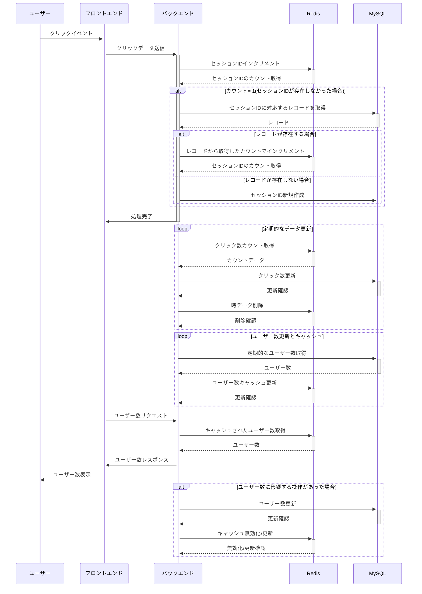

# 起動方法

## コンテナ起動

ターミナルで下記コマンド実行

```
docker compose up -d
```

## ブラウザアクセス

下記URLをブラウザのアドレスバーに入力

```
localhost:3000
```

# コンテナの各サービス概要

- back
  - バックエンド
  - APIs
    1. POST /session -b 'session=<SESSION_ID>'
       - click event
       - redisのkey:<SESSION_ID>に対応するvalueをカウントアップ。keyが存在しなければvalue=1としてレコード作成
    2. PUT /session
       - 定期実行
       - redisのkey, valueからMySQLのテーブルSessionCounterをupsert
       - redisのvalueがSessionCounterのsessionIdに存在する場合、対象レコードを(key, value + count) -> (sessionId, count)として更新
       - redisのvalueがSessionCounterのsessionIdに存在しなければ、(key, value) -> (sessionId, count)として新規レコード作成
    3. POST /count
       - 定期実行
       - SessionCounter.countの合計をCountSummaryに1レコード追加
- front
  - フロンエンド
  - 1秒おきに(i)のAPIをコールして表示
- redis
  - timestampsテーブルを配置
- cron
  - 1分おきに(ii)のAPIをコール

## シーケンス図



## Table Definitions

[session_counter](./doc/KazoeruKun/session_counter.md)

[count_summary](./doc/KazoeruKun/count_summary.md)
