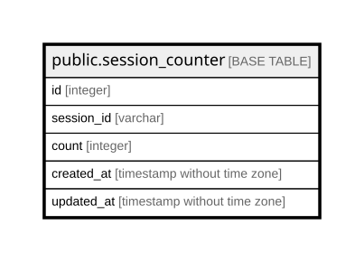

# public.session_counter

## Description

## Columns

| Name | Type | Default | Nullable | Children | Parents | Comment |
| ---- | ---- | ------- | -------- | -------- | ------- | ------- |
| id | integer | nextval('session_counter_id_seq'::regclass) | false |  |  |  |
| session_id | varchar |  | false |  |  |  |
| count | integer |  | false |  |  |  |
| created_at | timestamp without time zone | CURRENT_TIMESTAMP | false |  |  |  |
| updated_at | timestamp without time zone | CURRENT_TIMESTAMP | false |  |  |  |

## Constraints

| Name | Type | Definition |
| ---- | ---- | ---------- |
| session_counter_pkey | PRIMARY KEY | PRIMARY KEY (id) |
| session_counter_session_id_key | UNIQUE | UNIQUE (session_id) |

## Indexes

| Name | Definition |
| ---- | ---------- |
| session_counter_pkey | CREATE UNIQUE INDEX session_counter_pkey ON public.session_counter USING btree (id) |
| session_counter_session_id_key | CREATE UNIQUE INDEX session_counter_session_id_key ON public.session_counter USING btree (session_id) |

## Relations

---

> Generated by [tbls](https://github.com/k1LoW/tbls)
