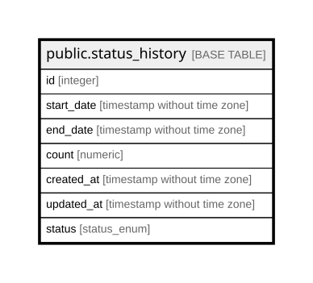

# public.status_history

## Description

## Columns

| Name | Type | Default | Nullable | Children | Parents | Comment |
| ---- | ---- | ------- | -------- | -------- | ------- | ------- |
| id | integer | nextval('count_summary_id_seq'::regclass) | false |  |  |  |
| start_date | timestamp without time zone |  | false |  |  |  |
| end_date | timestamp without time zone |  | false |  |  |  |
| count | numeric |  | false |  |  |  |
| created_at | timestamp without time zone | CURRENT_TIMESTAMP | false |  |  |  |
| updated_at | timestamp without time zone | CURRENT_TIMESTAMP | false |  |  |  |
| status | status_enum | 'CLEAN'::status_enum | false |  |  |  |

## Constraints

| Name | Type | Definition |
| ---- | ---- | ---------- |
| count_summary_pkey | PRIMARY KEY | PRIMARY KEY (id) |

## Indexes

| Name | Definition |
| ---- | ---------- |
| count_summary_pkey | CREATE UNIQUE INDEX count_summary_pkey ON public.status_history USING btree (id) |

## Relations

---

> Generated by [tbls](https://github.com/k1LoW/tbls)
